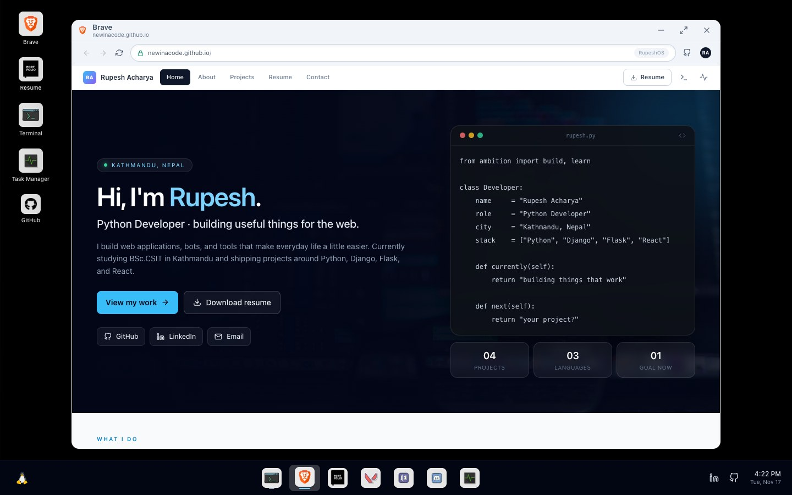
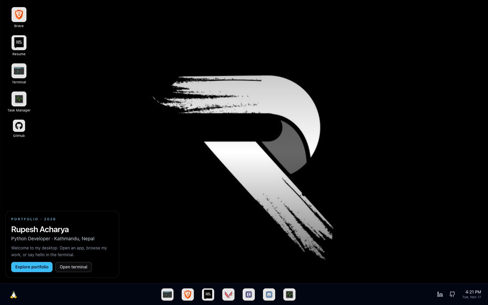

# Rupesh Acharya — Portfolio OS

An interactive, desktop-style personal portfolio for **Rupesh Acharya**, a Python developer based in Kathmandu, Nepal. Instead of a scrolling page, the site boots into a small operating system in the browser: draggable windows, a start menu, a working terminal, a task manager, and a browser with the full profile site inside it.

**Live:** [newinacode.github.io](https://newinacode.github.io/)





## Features

- **Desktop shell** — wallpaper, desktop shortcuts, a start menu with search, a live clock, and window focus management.
- **Draggable windows** — minimize, maximize, close, and bring windows to the front. Windows are responsive and become full-screen on mobile.
- **Brave browser** — a complete portfolio inside a browser window with Home, About, Projects, Resume, and Contact pages.
- **Working terminal** — commands including `help`, `about`, `projects`, `skills`, `contact`, `open <app>`, `neofetch`, `ls`, `cat`, and history/autocomplete support.
- **Resume viewer** — preview the original PDF, download it, or open it in a new tab.
- **Task Manager** — see every open window, focus, z-index, and end tasks.
- **Power controls** — restart or shut down the little OS from the start menu.
- **Profile content** — projects, education, skills, languages, and contact links pulled from a single `profile.js` data file.

## Apps

| App | What it does |
| --- | --- |
| Brave | Full profile website: home, about, projects, resume, contact |
| Terminal | Interactive shell with real commands and virtual files |
| Resume | PDF viewer + download |
| Task Manager | Running windows and process controls |
| Discord | Community invite |
| Valorant / Fortnite | A couple of gaming detours |

## Tech stack

- React 18
- Redux
- Tailwind CSS 3
- Create React App
- GitHub Pages

## Run locally

```bash
npm install
npm start
```

The app runs at [http://localhost:3000](http://localhost:3000).

## Build

```bash
npm run build
```

The production build is written to `build/`.

## Deploy to GitHub Pages

```bash
npm run deploy
```

This builds the app and publishes the `build/` folder to the `gh-pages` branch. The site is configured for `https://newinacode.github.io/`.

## Project structure

```text
src/
  actions/           Redux actions for opening, focusing, and closing windows
  components/
    App/             Individual app windows (Brave, Terminal, Resume, ...)
    UI/              Desktop shell, taskbar, start menu, window chrome
  config/
    apps.js          App metadata used by the taskbar, start menu, and task manager
    profile.js       All portfolio content in one place
  reducers/          Window/start-menu state
```

## Editing content

Most content lives in [`src/config/profile.js`](src/config/profile.js) — name, summary, links, skills, projects, education, and languages. App names, icons, and search keywords live in [`src/config/apps.js`](src/config/apps.js).

## License

Personal project. The code is free to learn from; the content, resume, and artwork belong to Rupesh Acharya.
